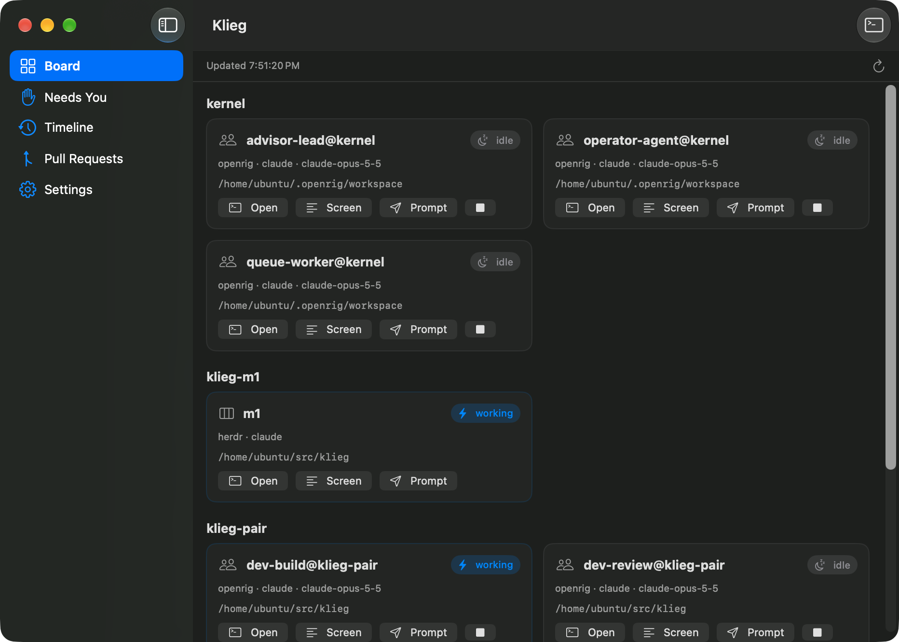
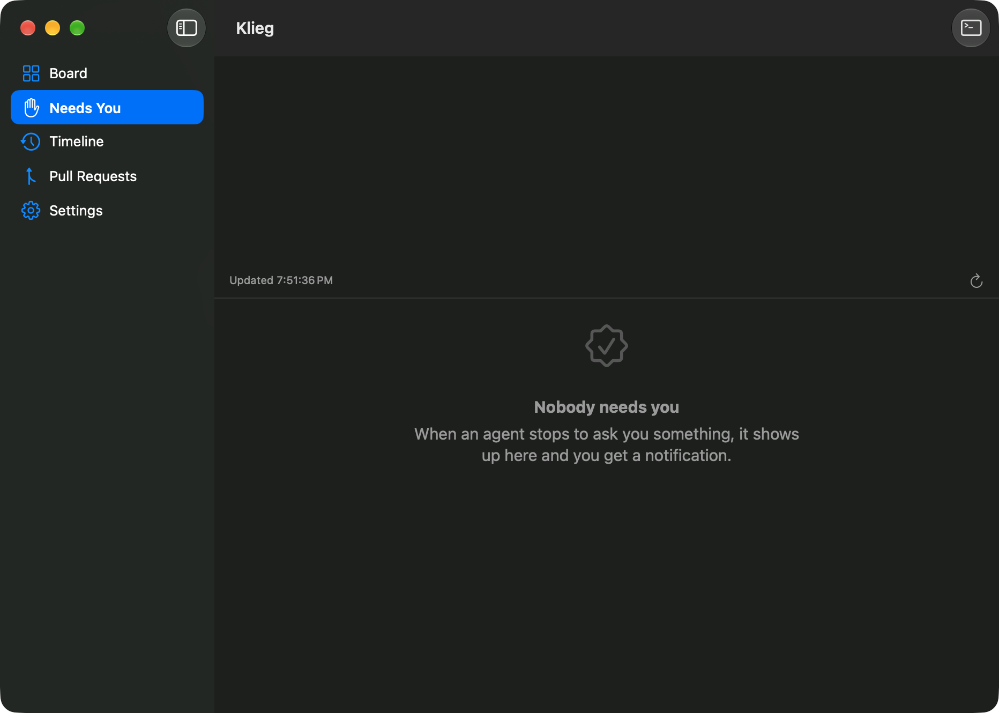
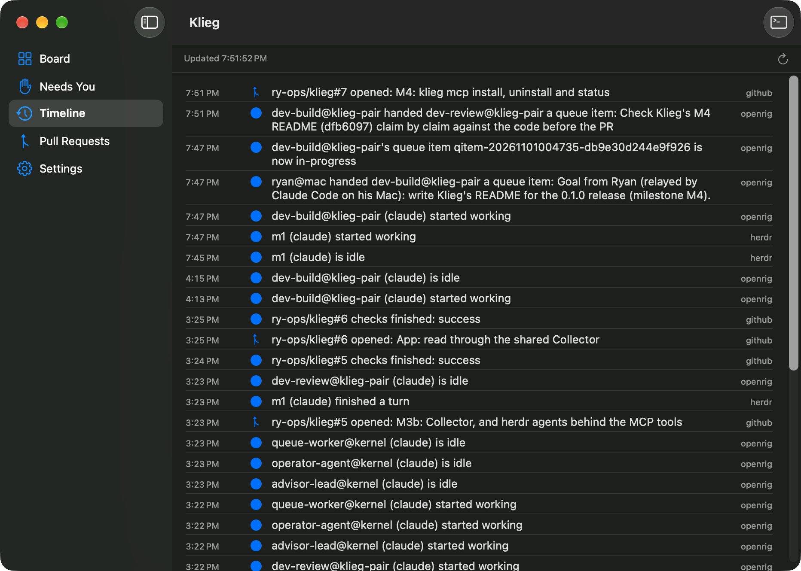
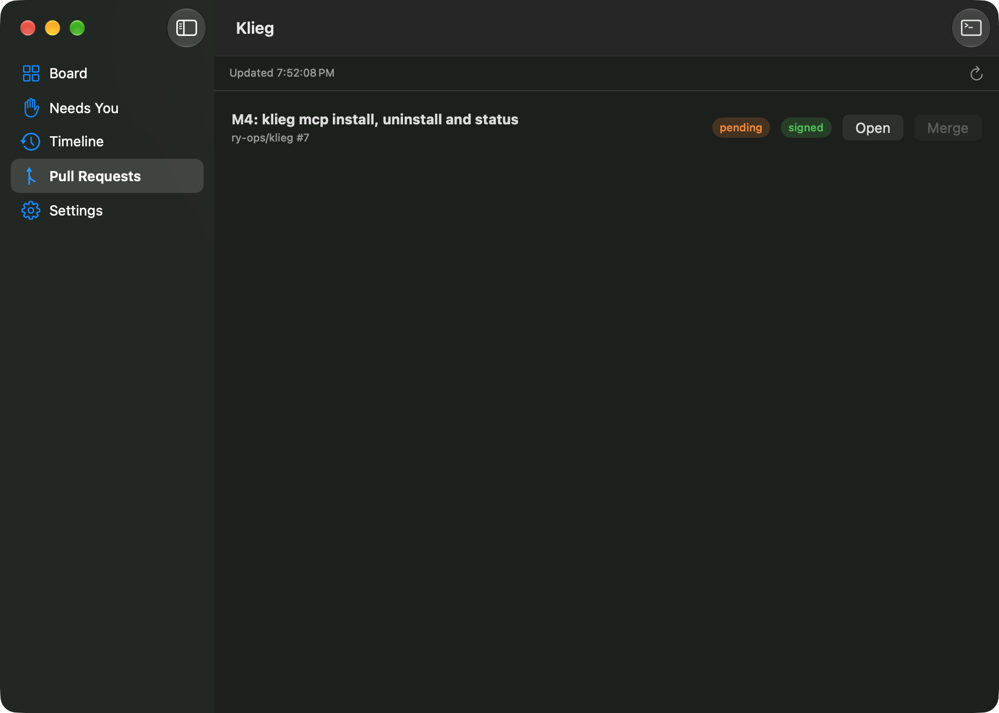

# Klieg

**A spotlight on your coding agents.** Klieg watches and steers [herdr](https://herdr.dev) agents and [OpenRig](https://www.npmjs.com/package/@openrig/cli) rigs from one place: a native macOS app with a built-in terminal, a `klieg` command-line tool, and an MCP server so Claude can see and drive them too.



Klieg doesn't run agents itself. It reads what herdr, OpenRig and GitHub already know, using the `herdr`, `ssh`, `rig` and `gh` commands you have set up, and puts it in one place: who is working, who is stuck, and which agent is waiting on you. When you act from Klieg, it runs those same commands for you. [Security and privacy](#security-and-privacy) says exactly what each action can do.

## What's inside

| Surface | What it gives you |
| --- | --- |
| **Klieg app** | A Board of every agent and seat, a Needs You list with macOS notifications, a Timeline, open Pull Requests with CI and signing status, Settings, a menu-bar count of agents waiting on you, and a built-in terminal that opens any agent's live session in one click. |
| **`klieg` CLI** | `klieg status` and `klieg timeline --watch` from any shell, plus prompting and reading herdr agents. |
| **MCP server** (`klieg mcp`) | 12 tools that let Claude read state and act: prompt agents, queue goals for OpenRig seats, start and stop agents, bring rigs up and down, answer prompts and merge green, signed PRs. Read-only mode turns every action off. |

## Requirements

- A Mac running macOS 27 or later, for the app
- **Command Line Tools only.** You don't need the Xcode app. Install them with `xcode-select --install`. They include Swift 6.2 or later.
- A network connection for the first build, which downloads [SwiftTerm](https://github.com/migueldeicaza/SwiftTerm) for the app's terminal
- For each thing you want to watch:
  - **herdr:** `herdr` on this Mac, with the herdr machine saved (`herdr machine add`). Or run Klieg on the herdr host itself.
  - **OpenRig:** `ssh` access to the host running the OpenRig daemon, with a key that logs in without a password prompt, and `rig` on that host's `PATH` for non-interactive shells. Or run Klieg on the OpenRig host itself.
  - **GitHub:** `gh`, signed in (`gh auth login`)

The core library, the CLI and the MCP server also build and run on Linux. The app is macOS only.

## Build and install

```bash
git clone https://github.com/ry-ops/klieg.git ~/Projects/klieg
bash ~/Projects/klieg/scripts/build-app.sh --install
```

That builds `build/Klieg.app` with the `klieg` command inside it and copies it to `/Applications` (or `~/Applications` if you can't write to `/Applications`). It quits a running copy first, then links `~/.local/bin/klieg` to the bundled command.

```bash
bash scripts/build-app.sh          # build only, into build/Klieg.app
swift build --product klieg        # just the CLI and MCP server (macOS or Linux)
swift run klieg-selftest           # the self-test
```

`build-app.sh` sets `DEVELOPER_DIR` to the Command Line Tools, so it works even when `xcode-select` points at Xcode. Set `KLIEG_DEVELOPER_DIR` to use another toolchain folder. The app is signed ad hoc.

## Configure

Settings live in `~/.config/klieg/config.json`. The easiest way to write it is the app's Settings section, which saves every key. To write it by hand, include all six keys:

```json
{
  "herdrMachine": "herdr",
  "herdrSession": "work",
  "openrigHost": "ubuntu@100.67.70.121",
  "repos": ["ry-ops/klieg"],
  "refreshSeconds": 5,
  "readOnly": false
}
```

| Key | What it does | Default |
| --- | --- | --- |
| `herdrMachine` | The herdr machine label, as saved with `herdr machine add`. Klieg runs `herdr --machine <label> …`. The label is also the ssh host used to open a herdr pane in the terminal. `null` or `""` means the herdr server on this computer. | `"herdr"` |
| `herdrSession` | The herdr session to read. | `"work"` |
| `openrigHost` | The ssh target of the host running the OpenRig daemon. Klieg runs `ssh -o BatchMode=yes <host> rig …`. `null` runs `rig` on this computer. (Use `null`, not `""`: an empty string here is passed to ssh as a host name.) | `"ubuntu@100.67.70.121"` |
| `repos` | GitHub repos to watch for pull requests, as `owner/name`. | none |
| `refreshSeconds` | Seconds between refreshes in the app and in `klieg timeline --watch`. | `5` |
| `readOnly` | `true` refuses every action. | `false` |

The defaults match the homelab Klieg was built for, so set `herdrMachine` and `openrigHost` for yours.

Two things to know when editing by hand:

- **A file that's missing `herdrSession`, `repos`, `refreshSeconds` or `readOnly`, or that isn't valid JSON, is ignored, and Klieg uses the defaults for everything.** Run `klieg config` to see the settings Klieg actually uses.
- **A missing `herdrMachine` or `openrigHost` means "this computer"**, not the default.
- **`"openrigHost": ""` doesn't mean this computer**: Klieg tries to ssh to an empty host name. Use `null`. (An empty `KLIEG_OPENRIG_HOST` and an empty OpenRig field in Settings both do mean this computer.)

Klieg also uses the local herdr server, even with `herdrMachine` set, when it runs inside a herdr pane, or when the label isn't one of the machines `herdr machine list` shows (it assumes it's on the herdr host).

### Environment variables

| Variable | What it does |
| --- | --- |
| `KLIEG_READ_ONLY` | `1`, `true` or `yes` turns read-only mode on. Any other value turns it off, whatever the file says. |
| `KLIEG_OPENRIG_HOST` | Overrides `openrigHost`. Empty means this computer. |
| `KLIEG_HERDR_MACHINE` | Overrides `herdrMachine`. Empty means this computer. |
| `KLIEG_HOME` | Uses this folder instead of `~/.config/klieg` for the config file and the CLI's timeline. |
| `KLIEG_DEVELOPER_DIR` | The toolchain folder `build-app.sh` uses. The default is `/Library/Developer/CommandLineTools`. |

## What Klieg shows

Every agent gets one of these states, whether it comes from herdr or OpenRig:

| State | Meaning |
| --- | --- |
| `working` | Busy with a turn. |
| `blocked` | Waiting on a person: a permission, a question, a folder-trust screen or a usage-credit prompt. These agents are the ones that "need you". |
| `idle` | Ready for input. |
| `done` | Finished a turn you haven't looked at yet. |
| `unknown` | Present, but its state can't be read with confidence. |
| `stopped` | The process is gone. |

When Klieg knows why an agent is blocked, it says so:

- `permission_prompt`: OpenRig's reason when a seat is asking to approve something.
- `approval_or_question`: a herdr agent that herdr reports as blocked.
- `trust_prompt`: Claude Code's first-run "do you trust this folder" screen. herdr reports that screen as idle, so Klieg reads the pane and marks it blocked.
- `billing`: OpenRig reports a usage-credit or billing screen as a permission prompt. Klieg reads each blocked seat's screen and labels those `billing`, because only you should answer them.

Agent ids are `herdr:<machine>/<pane>` (for example `herdr:herdr/w1:p1`) and `openrig:<session>` (for example `openrig:dev-build@my-rig`). OpenRig's own infrastructure panes aren't listed.

## The app

The sidebar has five sections:

- **Board:** every herdr agent and OpenRig seat with its state, model and group (herdr workspace or OpenRig rig), plus the open OpenRig queue. A strip at the top shows any source Klieg couldn't read.
- **Needs You:** every blocked agent and why, in plain words. Klieg posts a macOS notification when an agent starts needing you.

  

- **Timeline:** state changes, agents appearing and stopping, OpenRig queue items arriving and moving between pending, in progress and blocked, and pull requests opening and their checks finishing, as they happen. Items that finish and PRs that merge or close drop out of view rather than getting an event; `klieg_timeline` over MCP does show finished queue items.

  

- **Pull Requests:** open PRs in your watched repos, with check status and whether the head commit is signed.

  

- **Settings:** the herdr machine and session, the OpenRig host, the repos, the refresh interval and read-only mode. **Save** writes `~/.config/klieg/config.json`.

Each agent card has these buttons:

| Button | What it does |
| --- | --- |
| **Open** | Opens the agent's live session in a new tab of the built-in terminal: `tmux attach` for an OpenRig seat (over `ssh -t` when the host is remote), `herdr agent attach` for a herdr agent. |
| **Screen** | Shows the agent's recent terminal text. |
| **Prompt** | Sends a message into the agent's session, as if you typed it there. Not offered while the agent is blocked or stopped. |
| **Answer** | For a blocked OpenRig seat: shows the screen, then types the answer you give. Off for `billing` prompts. **Open seat instead** takes you to the terminal. |
| **Stop** (■) | For an OpenRig seat: asks you to confirm, then stops that seat. Its rig stays up. |

On the Pull Requests page, **Merge** is on only when every check passed and the head commit is signed. It asks you to confirm, and the merge checks both again. In read-only mode, every action button is off.

The menu-bar icon shows how many agents need you. Its menu lists them, and choosing one opens Needs You.

### The terminal

The terminal panel sits at the bottom of the window. Control-` shows or hides it, and Control-Shift-` opens a new tab. Each tab runs your login shell, and **Open** runs its attach command through that login shell. Your `PATH` and ssh config therefore work as they do in your own terminal.

## The CLI

```
klieg version                      Print the version
klieg config                       Print the settings Klieg uses (JSON)
klieg mcp                          Run the MCP server on stdio
klieg status [--json]              Agents, their state, and who needs you
klieg timeline [--watch] [--json]  What changed since last time (--watch keeps going)
klieg herdr prompt <agent> <text>  Send a prompt to a herdr agent
klieg herdr read <agent> [lines]   Print a herdr agent's recent terminal text (default 80 lines)
```

- **`klieg status`** prints a table of agents, the open OpenRig queue, open pull requests and who needs you, with the command that opens each waiting agent. It exits with 1 when any source couldn't be read, and says which one.
- **`klieg timeline`** compares what Klieg sees now with what it saw last time (the same events as the app's Timeline) and keeps the events (up to 500) in `~/.config/klieg/timeline.jsonl`. It prints the last 50. `--watch` prints the last 10, then new events as they happen. `--json` prints one JSON object per line.
- **`klieg herdr`** takes a Klieg id (`herdr:<machine>/<pane>`), a herdr pane id (`w1:p1`) or an agent name. herdr refuses a prompt while the agent is waiting on a person.

## Claude integration (MCP)

`klieg mcp` is a Model Context Protocol server over stdio: plain JSON-RPC 2.0, one request per line, with no SDK. It uses the same settings as the app and the CLI.

Register it with Claude Code and Claude Desktop in one step:

```bash
klieg mcp install --read-only   # Claude can see everything; every action is refused
klieg mcp install               # Claude can also prompt, queue, start/stop, answer and merge
klieg mcp status                # where klieg is registered, with which command and env
klieg mcp uninstall             # remove only the klieg entry
```

- `--client claude-code|claude-desktop|all` picks which clients (default: every client found on this machine). `--dry-run` prints what would change.
- Claude Code is registered with `claude mcp add --scope user` when the `claude` CLI is installed, otherwise by editing `mcpServers` in `~/.claude.json`. Claude Desktop is registered in `~/Library/Application Support/Claude/claude_desktop_config.json`; restart Claude Desktop afterwards.
- Config files are edited atomically and only the `klieg` entry changes. A file that isn't valid JSON is left alone.
- Install from the installed app (`~/.local/bin/klieg`), not from a `.build/` folder: a rebuild or clean moves that binary.

### Tools

**Read** tools change nothing. **Act** tools change something and are refused in read-only mode. **Destructive** act tools carry `destructiveHint: true`, so a client such as Claude Code can ask you before using them. The hint is advisory: Klieg can't make a client ask.

| Tool | Kind | Arguments | What it does |
| --- | --- | --- | --- |
| `klieg_status` | read | none | Every herdr agent and OpenRig seat with its state, who needs you and why, and the open OpenRig queue. |
| `klieg_timeline` | read | `limit` (default 30) | Recent activity, newest first: agent state changes, and queue items queued, claimed, blocked, handed off and finished. |
| `klieg_read_agent` | read | `agent`, `lines` (default 40) | The last lines of an agent's terminal. |
| `klieg_pull_requests` | read | `repo` (optional) | Open PRs in one repo or every watched repo, with check status and whether the head commit is signed. |
| `klieg_prompt_agent` | act | `agent`, `text` | Types a message into the agent's terminal and presses Enter. OpenRig and herdr both refuse while the agent is stopped at a prompt. |
| `klieg_queue_goal` | act | `destination`, `body` | Hands a goal to an OpenRig seat as a queue item from `klieg@external`. The first line of `body` becomes its summary. OpenRig seats only. |
| `klieg_start_agent` | act | `name`, `kind`, `pane` (optional) | Starts a coding agent (for example `claude` or `codex`) in a herdr pane. Without `pane`, it makes a new herdr workspace named after the agent. herdr only: OpenRig seats start with their rig. |
| `klieg_stop_agent` | destructive | `agent` | OpenRig: stops that one seat (`rig seat stop`). herdr: closes the agent's pane. Either way any turn in progress ends. |
| `klieg_rig_up` | act | `spec` | Runs `rig up` with a spec path, library name or bundle link, or the name of a stopped rig. |
| `klieg_rig_down` | destructive | `rig` | Runs `rig down`: stops every seat in the rig. OpenRig snapshots the rig first. |
| `klieg_answer_prompt` | destructive | `agent`, `answer` | Answers the prompt an agent is stopped at. OpenRig: types `answer` into the seat. herdr: sends key names separated by spaces, such as `1`, `y enter` or `esc`. Refuses billing and usage-credit prompts. |
| `klieg_merge_pr` | destructive | `repo`, `number` | Squash-merges a PR, only when it's open, not a draft, every check passed and the head commit is signed and verified. |

`agent` is an id from `klieg_status`. A bare OpenRig session name such as `dev-build@my-rig` works too.

## Guardrails

- **Read-only mode.** With `readOnly` on (Settings, the config file or `KLIEG_READ_ONLY=1`), the MCP server refuses every act tool and changes nothing. The herdr client refuses actions on its own as well, and the app turns its action buttons off. Reading still works.
- **Billing and usage-credit prompts are yours.** Before answering a prompt, Klieg reads the agent's screen again. It refuses if the last 30 lines mention any of: usage credit, credits, billing, extra usage, extra-usage, usage limit, rate limit, payment, purchase, add funds, subscription, upgrade your plan, spend limit or spending limit. For an OpenRig seat it reads the whole pane at a readable size. It refuses when the window is too small to show the whole prompt. The app turns **Answer** off for `billing` prompts.
- **Merging needs green and signed.** `klieg_merge_pr` and the app's **Merge** refuse a PR that is closed, a draft, has no checks, has a check that failed or is still running, or whose head commit isn't verified by GitHub. Skipped and neutral checks count as passed. The merge is pinned to the head commit Klieg checked (`gh pr merge --squash --match-head-commit`), so a push in between makes it fail.
- **Confirmations.** In the app, stopping a seat and merging a PR each ask you first. Answering a prompt shows you the screen before you type. Over MCP, the four destructive tools are marked destructive so a client can ask you first, and Klieg's server instructions tell Claude to confirm with you. Klieg itself doesn't wait for a confirmation over MCP.

### Known gaps

- Answering an OpenRig prompt reads the screen and then sends the keys as two separate steps. If the prompt changes in between, the keys go to the new prompt. OpenRig records every such send with the reason "Answered by the person through Klieg".
- Stopping a herdr agent closes its pane. herdr has no gentler stop that works for every agent kind.

## Security and privacy

**What runs where.** Klieg runs on your Mac, or on Linux for the CLI and MCP server. It has no server of its own and makes no network requests itself. Everything it reads or does goes through these commands, run as you:

| To reach | Klieg runs | Using |
| --- | --- | --- |
| herdr | `herdr --machine <label> …`, or `herdr --session <s> …` on the herdr host | herdr's own machine connection |
| OpenRig | `ssh -o BatchMode=yes <openrigHost> rig …`, or `rig …` on the OpenRig host | your ssh keys and config |
| GitHub | `gh pr list`, `gh pr view`, `gh api …/commits/<sha>`, `gh pr merge` | your `gh` sign-in |
| A live session | `ssh -t <host> tmux attach -t <seat>` or `herdr agent attach` | your ssh keys and config |

**Credentials.** Klieg uses your existing ssh, herdr and `gh` credentials and never sees them. It doesn't ask for, store or send any token or password.

**What it stores.** All of it is plain text in `~/.config/klieg`:

- `config.json`: your settings.
- The CLI's timeline: `timeline.jsonl` and `last-snapshot.json`. They hold agent names, states, working folders, models and OpenRig queue summaries.
- The app's timeline: the same two files in `app/`.

The app also keeps the terminal's height and text size in its macOS preferences.

**What each action can do.** Every act tool and app button maps to one command:

| Action | Runs | Effect |
| --- | --- | --- |
| Prompt | `rig send <seat> <text>` or `herdr agent prompt` | Types text into the agent's session and presses Enter. The agent acts on it like anything you type. |
| Queue goal | `rig queue create --source klieg@external …` | Adds a durable work item for an OpenRig seat. |
| Start agent | `herdr agent start` (and `herdr workspace create` when no pane is given) | Starts a new coding agent in herdr. |
| Stop agent | `rig seat stop <seat>` or `herdr pane close` | Ends that agent's session and any turn in progress. |
| Rig up | `rig up <spec>` | Launches a rig's seats on the OpenRig host. |
| Rig down | `rig down <rig>` | Stops every seat in a rig. |
| Answer prompt | `rig send <seat> <answer> --dangerously-interact --reason …` or `herdr agent send-keys` | Answers a permission or question prompt, which can approve whatever the agent asked to do. Never a billing prompt. |
| Merge PR | `gh pr merge --squash --match-head-commit <sha>` | Squash-merges into the base branch. |

If you want Claude to watch your agents without being able to change anything, register the MCP server with `KLIEG_READ_ONLY=1`.

## How Klieg is built

Klieg is built by three builders working at the same time, and it watched itself being built: the agents writing it showed up on its own Board and Timeline.

| Builder | Where | Built |
| --- | --- | --- |
| **A herdr agent** | a herdr pane on the herdr VM | the herdr client, the Timeline and the CLI |
| **An OpenRig rig**, a builder seat and a reviewer seat | the OpenRig VM | the OpenRig and GitHub clients and the MCP server. The reviewer checked each change before it was opened as a PR. |
| **Claude Code on the Mac** | Ryan's Mac mini | the skeleton, the app and everything macOS-only |

Each piece arrived as its own PR against `main`. The plan, milestone by milestone, is in [ROADMAP.md](ROADMAP.md). The rules every builder follows are in [AGENTS.md](AGENTS.md).

## Troubleshooting

- **"couldn't read openrig".** Check `ssh -o BatchMode=yes <openrigHost> rig ps` works from a plain terminal. BatchMode never asks for a password, so the key must log in on its own. `rig` must also be on the remote `PATH` for non-interactive shells.
- **"couldn't read herdr".** Check `herdr machine list` shows your `herdrMachine` label, or clear the label to use the herdr server on this computer.
- **Settings in `config.json` are ignored.** The file must have every key. See [Configure](#configure). `klieg config` shows what Klieg uses.
- **No pull requests.** Add repos in Settings or `repos`, and check `gh auth status`.
- **No notifications.** They work only in the installed app, not under `swift run`. Allow Klieg in System Settings > Notifications.
- **The app can't find `herdr`, `rig` or `gh`.** Apps opened from Finder get a short `PATH`. Klieg also looks in `~/.local/bin`, `/opt/homebrew/bin`, `/usr/local/bin`, `/usr/bin` and `/bin`.

## Uninstall

```bash
claude mcp remove --scope user klieg                 # if you registered the MCP server
rm -rf /Applications/Klieg.app ~/Applications/Klieg.app ~/.local/bin/klieg
rm -rf ~/.config/klieg                               # settings and timelines
defaults delete dev.ry-ops.klieg                     # terminal height and text size
```

## Project layout

```
Sources/KliegKit     models, config, the herdr, OpenRig and GitHub clients, the Collector and the Timeline
Sources/KliegServer  the MCP server and its tools
Sources/KliegCLI     the klieg command
Sources/KliegApp     the SwiftUI app, including the terminal (TerminalView.swift); macOS only
Tests/SelfTest       the self-test, with recorded herdr, rig and gh output in Fixtures/
scripts/build-app.sh builds and installs Klieg.app
docs/images/         screenshots
```

```bash
swift build --product klieg
swift run klieg-selftest
```

The self-test is a plain executable, so it needs neither XCTest nor Xcode. It replays recorded output from `herdr`, `rig` and `gh`, so it never touches a live agent or GitHub. On Linux, `swift build` rewrites or deletes `Package.resolved`, because SwiftTerm is macOS only. Don't commit that change (`git checkout -- Package.resolved`).

## License

MIT. The built-in terminal uses [SwiftTerm](https://github.com/migueldeicaza/SwiftTerm) (MIT).
